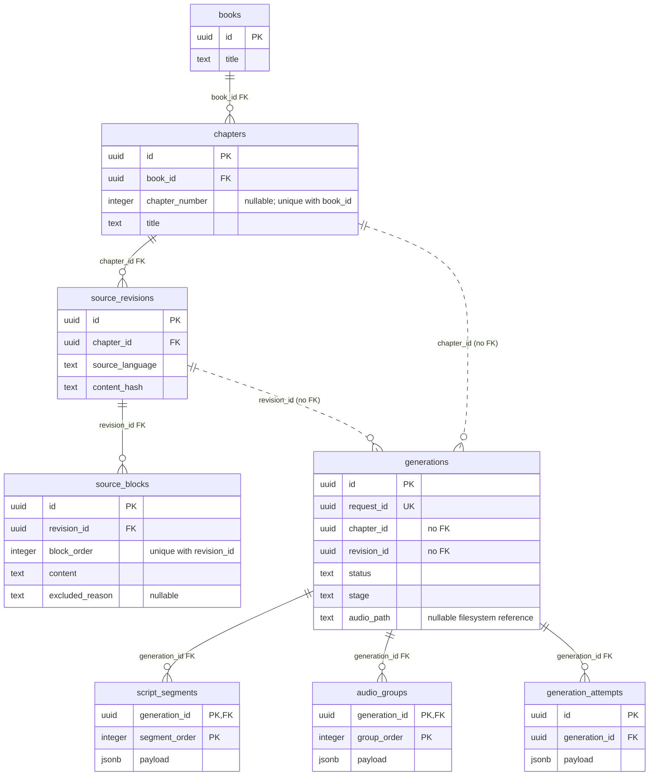

# Bookcast data model

Verified against Flyway V1–V3 and current adapters on 2026-11-11. Technical columns are selectively omitted.

## Tables and relationships

**PK/UK/FK** mean primary/unique/foreign key; multiple PK fields form a composite key. Solid links are enforced foreign keys: one parent per child, zero or more children per parent. Dashed links are application-validated references, **not foreign keys**; their cardinalities describe valid application data, not SQL guarantees. JSONB references are separate below.

SQL permits empty parents and does not enforce contiguous/nonnegative ordering. The application imports nonempty ordered source blocks transactionally and uses zero-based source/script/audio orders, explicitly sorted on reads. `chapter_number` is positive when present; NULL represents legacy chapters.

## JSONB contents and references

These are **not relational columns or foreign keys**. There are no separate turn, slice or usage tables.

The adapter copies segment/group orders into keys; SQL does not validate matching JSONB identifiers/orders or payload references. PCM, M4A, transcripts, candidates and configuration sidecars are local files; `audio_path` and receipt paths are filesystem references.

## Ownership and DDD boundaries

- **Library:** `LibraryService` transactionally appends revisions with their blocks; initial import also creates the Chapter. Book does not own a Java Chapter collection. `ChapterSource` is a joined public snapshot with ordered blocks.
- **Generation:** job identity scopes checkpoints and attempts, coordinated through `GenerationService`/`GenerationStore`. `Job` has no child collections; adapter `GenerationRow` does not give Spring Data ownership of checkpoint writes. No transaction spans the whole generation/provider work.
- These are ownership/consistency boundaries, not declared Java aggregate-root classes or an ORM graph. Foreign keys alone do not define DDD aggregates. Generation reads source through the public `Library` API.

## Lifetime and recovery

- **Source:** V1 triggers reject revision/block UPDATE/DELETE. Re-import creates new identities; changing Chapter placement does not rewrite source. The triggers protect existing rows, not prevent further INSERTs into a revision.
- **Accepted checkpoints:** V2 triggers reject script/audio UPDATE/DELETE. Resume reloads ordered checkpoints, validates plans and verifies PCM hashes; failed candidates are not checkpoints.
- **Execution:** job status (`queued`, `running`, `succeeded`, `failed`), stage, counters and error/audio reference are mutable. Each call gets a new attempt ID, but that row's JSONB is upserted through its lifecycle. Unknown cost remains null.
- **Idempotency:** globally unique `request_id` returns the original job for the same Chapter/revision; mismatched identity fails. `one_active_generation` permits one queued/running job per revision; competing creation returns that active job. A fresh key after completion creates independent work.
- **Retry:** failed status plus configuration checks permit explicit requeue of the same job, preserving checkpoints/history. The `retryable` flag is not a manual-retry gate. Startup interrupts running work without automatically resuming it.

## Domain/persistence differences

`generations.chapter_id`/`revision_id` have neither foreign keys nor a SQL constraint tying the pair together; `Library.revision(chapterId, revisionId)` checks them in the application.

`ChapterSource` joins **current** Book/Chapter metadata to immutable revision content; placement/number are not frozen, and `createdAt` is the revision timestamp. Legacy NULL chapter numbers remain readable, while new `ChapterPlacement` values require positive numbers. These differences are documented, not changed.

Sources: [V1](../backend/src/main/resources/db/migration/V1__library.sql), [V2](../backend/src/main/resources/db/migration/V2__generation.sql), [V3](../backend/src/main/resources/db/migration/V3__book_chapter_numbers.sql); [library mapping](../backend/src/main/java/com/bookcast/app/library/adapter/JdbcLibraryStore.java), [generation mapping](../backend/src/main/java/com/bookcast/app/generation/adapter/JdbcGenerationStore.java), [domain records](../backend/src/main/java/com/bookcast/app/generation/domain/Podcast.java), [generation orchestration](../backend/src/main/java/com/bookcast/app/generation/application/GenerationService.java). See also [ADR-0006](adr/adr-0006-source-model-and-imports.md).
