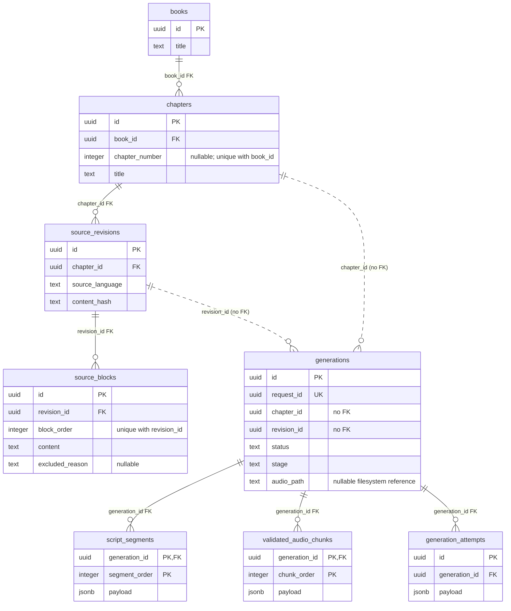

# Bookcast data model

Verified against Flyway V1–V4 and current adapters on 2026-11-15. Technical columns are selectively omitted.

Current Java names are `GenerationJob`, `DialogueSegment`, `DialogueTurn`, `SpeechChunk`, `TurnSpan`, `ProviderAttempt` and `ValidatedAudioChunk`. V4 renames the accepted audio table to `validated_audio_chunks` and its ordering column to `chunk_order`. JSONB properties (`group`, `segment`, `slices`, `turn`), enum values and artifact paths remain unchanged. Technical audio acceptance does not guarantee transcript accuracy or complete audible word coverage. See [the Java model](DOMAIN_MODEL.md) and [checkpointed pipeline](GENERATION_FLOW.md) for the distinction between a planned chunk and accepted audio.

## Tables and relationships

**PK/UK/FK** mean primary/unique/foreign key; multiple PK fields form a composite key. Solid links are enforced foreign keys: one parent per child, zero or more children per parent. Dashed links are application-validated references, **not foreign keys**; their cardinalities describe valid application data, not SQL guarantees. JSONB references are separate below.

SQL permits empty parents and does not enforce contiguous/nonnegative ordering. The application imports nonempty ordered source blocks transactionally and uses zero-based source/script/audio orders, explicitly sorted on reads. `chapter_number` is positive when present; NULL represents legacy chapters.

## JSONB contents and references

These are **not relational columns or foreign keys**. There are no separate turn, slice or usage tables.

The adapter copies `DialogueSegment.order` into `segment_order` and `ValidatedAudioChunk.group.order` into `chunk_order`; SQL does not validate matching JSONB identifiers/orders or payload references. PCM, M4A, transcripts, candidates and configuration sidecars are local files; `audio_path` and validated-chunk paths are filesystem references.

`SpeechChunk` is a planned rendering unit; it is embedded under the historical JSONB `group` key in a `ValidatedAudioChunk`. `AudioResult` is a capability response that may be incomplete or unsuccessful and is not an accepted checkpoint. `validated_audio_chunks.payload` stores accepted `ValidatedAudioChunk` values; `generation_attempts.payload` stores separate `ProviderAttempt` execution/accounting history. The M4A is the assembled final podcast, not a checkpoint payload.

The API's `completedSpeechChunks` counts persisted accepted chunks, while `totalSpeechChunks` counts planned chunks (the existing `generations.total_audio` column). A failed attempt or candidate file does not increase the completed count. These API names are independent of SQL column names and Java accessors.

## Ownership and DDD boundaries

- **Library:** `LibraryService` transactionally appends revisions with their blocks; initial import also creates the Chapter. Book does not own a Java Chapter collection. `ChapterSource` is a joined public snapshot with ordered blocks.
- **Generation:** job identity scopes checkpoints and attempts, coordinated through `GenerationService`/`GenerationStore`. `GenerationJob` has no child collections; adapter `GenerationRow` does not give Spring Data ownership of checkpoint writes. No transaction spans the whole generation/provider work.
- These are ownership/consistency boundaries, not declared Java aggregate-root classes or an ORM graph. Foreign keys alone do not define DDD aggregates. Generation reads source through the public `Library` API.

## Lifetime and recovery

- **Source:** V1 triggers reject revision/block UPDATE/DELETE. Re-import creates new identities; changing Chapter placement does not rewrite source. The triggers protect existing rows, not prevent further INSERTs into a revision.
- **Accepted checkpoints:** V2 triggers reject script/audio UPDATE/DELETE; V4 preserves them and renames the audio trigger to `validated_audio_chunks_immutable`. Resume reloads ordered checkpoints, validates plans and verifies PCM hashes; failed candidates are not checkpoints.
- **Execution:** job status (`queued`, `running`, `succeeded`, `failed`), stage, counters and error/audio reference are mutable. Each call gets a new attempt ID, but that row's JSONB is upserted through its lifecycle. Unknown cost remains null.
- **Idempotency:** globally unique `request_id` returns the original job for the same Chapter/revision; mismatched identity fails. `one_active_generation` permits one queued/running job per revision; competing creation returns that active job. A fresh key after completion creates independent work.
- **Retry:** failed status plus configuration checks permit explicit requeue of the same job, preserving checkpoints/history. The `retryable` flag is not a manual-retry gate. Startup interrupts running work without automatically resuming it.

## Domain/persistence differences

`generations.chapter_id`/`revision_id` have neither foreign keys nor a SQL constraint tying the pair together; `Library.revision(chapterId, revisionId)` checks them in the application.

`ChapterSource` joins **current** Book/Chapter metadata to immutable revision content; placement/number are not frozen, and `createdAt` is the revision timestamp. Legacy NULL chapter numbers remain readable, while new `ChapterPlacement` values require positive numbers. These differences are documented, not changed.

Sources: [V1](../backend/src/main/resources/db/migration/V1__library.sql), [V2](../backend/src/main/resources/db/migration/V2__generation.sql), [V3](../backend/src/main/resources/db/migration/V3__book_chapter_numbers.sql), [V4](../backend/src/main/resources/db/migration/V4__validated_audio_chunks.sql); [library mapping](../backend/src/main/java/com/bookcast/app/library/adapter/JdbcLibraryStore.java), [generation mapping](../backend/src/main/java/com/bookcast/app/generation/adapter/JdbcGenerationStore.java), [domain records](../backend/src/main/java/com/bookcast/app/generation/domain/Podcast.java), [generation orchestration](../backend/src/main/java/com/bookcast/app/generation/application/GenerationService.java). See also [ADR-0006](adr/adr-0006-source-model-and-imports.md).

## Applying V4 to existing local data

V4 uses only PostgreSQL rename operations: `audio_groups` → `validated_audio_chunks`, `group_order` → `chunk_order`, the primary/foreign-key constraint names, and the audio immutability trigger name. Renaming the primary-key constraint also renames its backing index. It retains the same table, keys, foreign key, indexes, trigger function and rows; it neither updates JSONB nor touches Library tables or files. V1–V3 remain unchanged.

[ValidatedAudioChunksMigrationTest](../backend/src/test/java/com/bookcast/app/generation/adapter/ValidatedAudioChunksMigrationTest.java) migrates a populated disposable V3 database and compares row counts/canonical row checksums for all eight application tables. It also checks unchanged table/storage, constraint, index and trigger identities, historical payload deserialization, PCM verification and checkpoint protections. [ProductFlowTest](../backend/src/test/java/com/bookcast/app/ProductFlowTest.java) exercises interrupted checkpoint reuse and ordered assembly on V4. These tests do not apply V4 to the persistent development database.

Before applying locally:

1. Stop the backend so no worker or HTTP request can change jobs during backup or migration. Keep PostgreSQL and its volume; do not run `docker compose down -v`.
2. Create a private backup directory outside the artifact directory. For the checked-in Compose database, save a custom-format dump with `docker compose exec -T postgres pg_dump -U bookcast -d bookcast -Fc > /absolute/private/backup-directory/bookcast-before-v4.dump`. Check the command's exit status. Substitute the actual database connection if local configuration differs.
3. Verify the archive with `pg_restore --list`, then **restore it into a separate disposable PostgreSQL database** and compare application row counts/checksums with the original. An archive listing alone is not a restore test. Record the original audio table as `generation_id, group_order, payload`; after migration compare `chunk_order AS group_order`. Preserve an independent copy of the configured `BOOKCAST_DATA_DIR` (default `backend/data` when launched from the backend), verifying the copied files against the originals. Do not proceed until the database restore and artifact copy are verified.
4. From the repository root, run `mvn -o -f backend/pom.xml spring-boot:run '-Dspring-boot.run.arguments=--bookcast.worker-enabled=false --bookcast.ai-mode=fake'` using the intended database configuration. Flyway applies V4 at startup. Disabling the worker also disables startup interruption recovery, so this inspection run neither claims queued jobs nor changes running statuses. Do not call generation/retry endpoints.
5. Confirm Flyway version 4, compare application row counts/checksums, inspect checkpoint constraints/trigger names and retain the verified backup. Stop the inspection process. Deploy the matching frontend/API changes together. Re-enable the normal backend worker only when ready for its usual startup recovery and queued work; that is separate from the schema migration. Never manually resume or regenerate historical work to validate the rename.
s