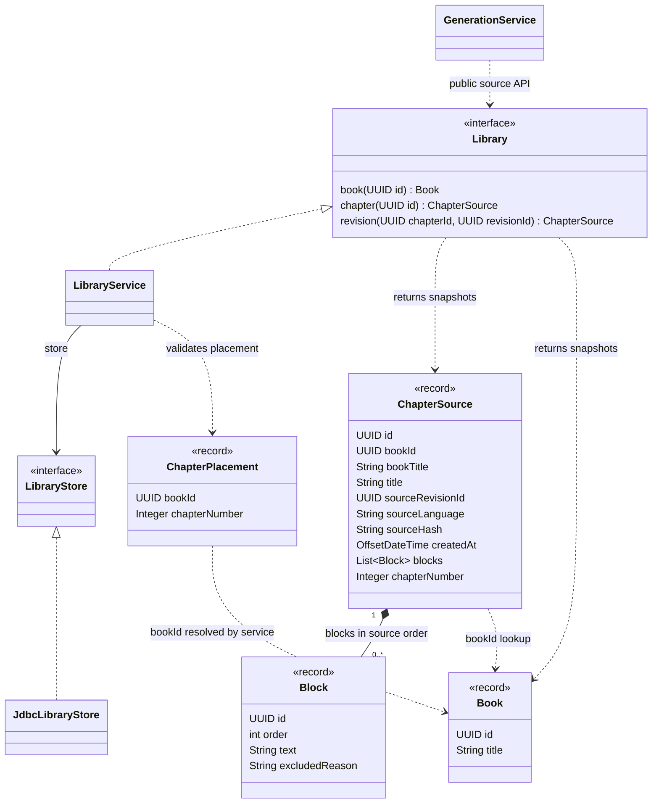
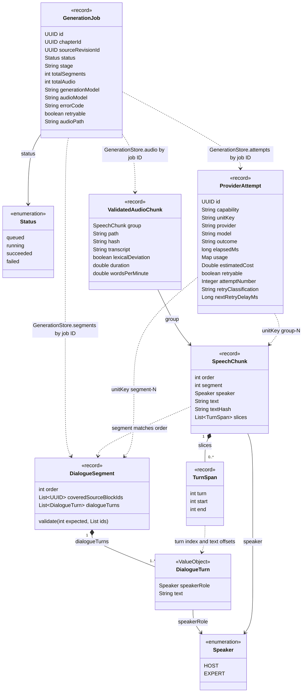
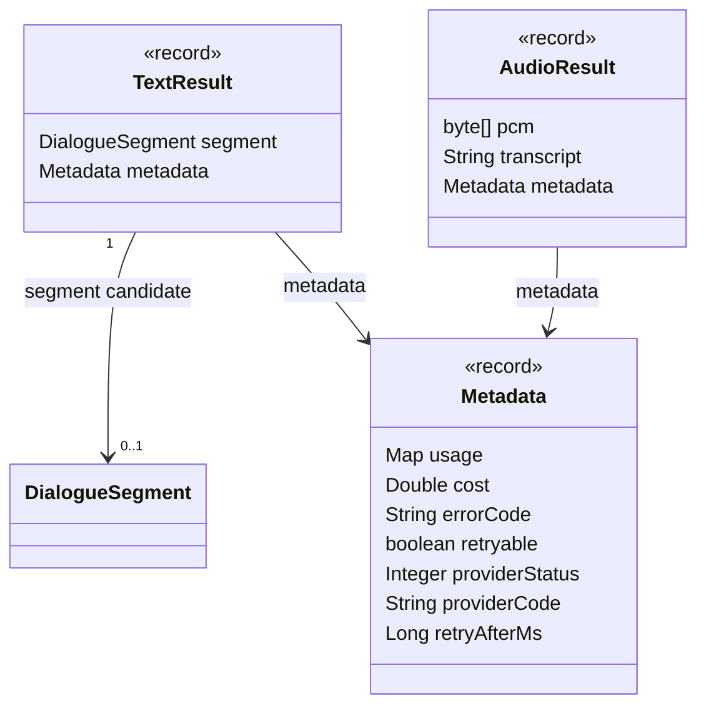

# Bookcast Java domain model

Verified against the Java implementation on 2026-11-15. These diagrams show records, fields and application contracts; [DATA_MODEL.md](DATA_MODEL.md) separately documents tables, keys and JSONB. [GENERATION_FLOW.md](GENERATION_FLOW.md) shows execution and recovery.

Solid arrows labelled with a field name represent actual Java references; diamonds indicate contained record values/lists, not JPA cascades or database ownership. Dashed arrows are dependencies, ID-based lookups or derived relationships, as labelled. Selected members are shown; no bidirectional relationships are implied.

These records describe a **restartable, checkpointed processing pipeline**: source blocks become `DialogueSegment` values, their turns become planned `SpeechChunk` values, validated PCM becomes `ValidatedAudioChunk` checkpoints, and assembly produces M4A. `GenerationJob` is the lifecycle snapshot; `GenerationService` performs the orchestration. The names do not add aggregate ownership or change the algorithm.

## Java names and stable stored names

The Java terminology is `GenerationJob`, `DialogueSegment`, `DialogueTurn`, `SpeechChunk`, `TurnSpan`, `SpeechChunkPlanner`, `ValidatedAudioChunk` and `ProviderAttempt`. `ValidatedAudioChunk` replaces the former `AudioReceipt` Java name. Stored records have no polymorphic class-name discriminator; the rename requires no JSON alias or historical data rewrite.

Existing properties and accessors remain deliberately unchanged: `TextResult.segment`, `ValidatedAudioChunk.group`, `SpeechChunk.segment`/`slices`, and `TurnSpan.turn`. The `group` property now contains a `SpeechChunk`, `segment` is its dialogue-segment ordinal, and `slices` contains `TurnSpan` values. SQL names (`script_segments`, `audio_groups`, `generation_attempts`), API schema names (`ScriptSegment`, `DialogueTurn`, `Attempt`), `group-N`/`segment-N` keys, stage strings and filesystem layouts are compatibility contracts, not Java type names. Renaming classes does not migrate historical payloads. [GenerationJsonCompatibilityTest](../backend/src/test/java/com/bookcast/app/generation/adapter/GenerationJsonCompatibilityTest.java) reads frozen pre-rename JSON shapes and checks serialization, hashes and spans.

## Library: chapter identity and source snapshots

There are no separate Java `Chapter`, `SourceRevision` or `SourceBlock` entity classes. `ChapterSource` represents a Chapter together with a selected revision and its ordered `ChapterSource.Block` records (`Block` below). Chapter identity is `id`; source identity is `sourceRevisionId`. IDs are plain UUIDs, not custom identifier classes.

`LibraryService` normalizes imports through `SourceNormalizer` and transactionally writes a Chapter plus its initial revision/blocks, or appends a new revision to an existing Chapter. The `ChapterSource` constructor copies its list; successful imports require learning content, although the record itself permits an empty block list. `excludedReason` can retain acquisition debris for inspection while generation skips it.

Revision content is immutable in the application and protected against row UPDATE/DELETE by Flyway triggers. Book membership and Chapter numbering can change independently. `ChapterPlacement` requires a positive number; legacy NULL numbers remain readable through `ChapterSource`. `ChapterSource.createdAt` is the revision timestamp, and its Book/Chapter display metadata comes from current rows, not a historical metadata snapshot.

The Book-to-Chapter association is resolved through IDs and store queries, not a Book-owned collection. `generation` depends only on the public `Library` interface and snapshots; it does not call `JdbcLibraryStore` or access library tables directly.

Review: [Book](../backend/src/main/java/com/bookcast/app/library/Book.java), [ChapterSource](../backend/src/main/java/com/bookcast/app/library/ChapterSource.java), [ChapterPlacement](../backend/src/main/java/com/bookcast/app/library/domain/ChapterPlacement.java), [LibraryService](../backend/src/main/java/com/bookcast/app/library/application/LibraryService.java), [JdbcLibraryStore](../backend/src/main/java/com/bookcast/app/library/adapter/JdbcLibraryStore.java). [LibraryTest](../backend/src/test/java/com/bookcast/app/LibraryTest.java), [LibraryFlowTest](../backend/src/test/java/com/bookcast/app/LibraryFlowTest.java) and [ArchitectureTest](../backend/src/test/java/com/bookcast/app/ArchitectureTest.java) cover source identity, placement and module boundaries.

## Generation: jobs, dialogue and accepted audio

All records and enums in this diagram are nested in `Podcast`. A `GenerationJob` is a scalar snapshot of mutable persisted execution state. Its checkpoints and attempts are fetched separately through `GenerationStore`; dashed store-lookup links are **not fields or child collections of GenerationJob**.

`DialogueSegment.validate` requires its expected ordinal, exactly the requested source-block IDs in order, and both speakers. Those UUIDs logically reference `ChapterSource.blocks`, not an embedded source object. `DialogueTurn` is a record annotated as a jMolecules value object; text must be nonblank. Structural checks do not prove semantic source coverage.

`SpeechChunkPlanner.plan` traverses all accepted segments/turns in order. Each SpeechChunk belongs to one segment and one speaker; contiguous same-speaker spans can be combined within that segment, up to 1,400 UTF-8 bytes. `TurnSpan.turn` is a segment-local turn index; `start`/`end` are Java string offsets (UTF-16 code units, end exclusive). SpeechChunk order is global within the job. Model constructors allow empty span lists; the planner creates slices for rendered text.

A `ValidatedAudioChunk` is produced after technical validation in the normal pipeline and becomes an accepted checkpoint when the service persists it. Construction or deserialization alone does not rerun validation or establish persistence. Technical acceptance does not guarantee transcript accuracy or complete audible word coverage; a lexical transcript deviation is diagnostic, not an automatic rejection. It contains the planned SpeechChunk and a filesystem PCM reference/hash; durations and silence measurements are seconds, speaking rate is words per minute. There is no explicit attempt ID in this value: attempt identity in an artifact path is not a Java or SQL relationship.

Each provider call gets a new ProviderAttempt ID. `unitKey` addresses a logical `segment-N` or `group-N`, including units without accepted checkpoints; these links are alternatives, not references to both objects. ProviderAttempt fields also include start/end timestamps and provider/error details omitted above. ProviderAttempt JSONB can change during that call's lifecycle; accepted DialogueSegment/ValidatedAudioChunk rows are insert-only. Unknown estimated cost is null; it is not zero usage.

Review: [Podcast](../backend/src/main/java/com/bookcast/app/generation/domain/Podcast.java), [SpeechChunkPlanner](../backend/src/main/java/com/bookcast/app/generation/domain/SpeechChunkPlanner.java), [DialogueText](../backend/src/main/java/com/bookcast/app/generation/domain/DialogueText.java), [GenerationStore](../backend/src/main/java/com/bookcast/app/generation/application/GenerationStore.java). [DomainTest](../backend/src/test/java/com/bookcast/app/DomainTest.java) checks turn-span coverage; [DialogueTextTest](../backend/src/test/java/com/bookcast/app/DialogueTextTest.java) covers speaker normalization; [GenerationPersistenceTest](../backend/src/test/java/com/bookcast/app/generation/adapter/GenerationPersistenceTest.java) checks immutable checkpoints and accounting.

## Capability results are candidates, not checkpoints

`TextResult`, `AudioResult` and `Metadata` belong to application `Capabilities`. A valid-looking provider result is not yet a persisted DialogueSegment or ValidatedAudioChunk. This distinction lets failed calls retain usage and partial output without accepting incomplete content.

The application normalizes/validates `TextResult.segment` before checkpointing; the segment may be null on failure. `AudioResult.pcm` is signed 16-bit little-endian mono PCM at 24 kHz, possibly empty/partial on error. It is preserved before waveform validation and receipt insertion. Usage maps contain reported long token counts; cost is estimated USD and retry delays are milliseconds. `GenerationService` copies accounting/classification into ProviderAttempt records; ProviderAttempt has no Metadata field. Provider `retryAfterMs` and the policy-selected `nextRetryDelayMs` are distinct.

`GenerationService` depends on `Library`, `GenerationStore` and three Bookcast-owned capability interfaces: `TextGeneration`, `SpeechRendering` and `AudioArtifacts`. `OpenAiText`, `OpenAiSpeech` and `LocalAudioArtifacts` implement those capabilities. `Profile(provider, model)` identifies the configured capability; `TextRequest` carries source blocks, the preceding segment's last four turns, languages and first/last flags. `AudioMetadata` carries Book/Chapter display tags for assembly. None of these contracts requires a vendor SDK in domain/application code.

`JdbcGenerationStore` implements the persistence port. Its restricted `GenerationReadRepository` reads adapter-only `GenerationRow` records, explicitly mapped to GenerationJob; it exposes no aggregate save/delete operations. SQL still owns atomic commands, JSONB attempts and checkpoint inserts. There is no ORM-managed GenerationJob graph or explicit Java aggregate-root class. Source import and individual persistence commands define transaction boundaries, not the entire podcast workflow. These are the practical ownership boundaries described in [ADR-0003](adr/0003-ddd-modular-monolith.md) and [ADR-0004](adr/0004-provider-independent-ai.md).

Review: [Capabilities](../backend/src/main/java/com/bookcast/app/generation/application/Capabilities.java), [GenerationService](../backend/src/main/java/com/bookcast/app/generation/application/GenerationService.java), [JdbcGenerationStore](../backend/src/main/java/com/bookcast/app/generation/adapter/JdbcGenerationStore.java), [GenerationReadRepository](../backend/src/main/java/com/bookcast/app/generation/adapter/GenerationReadRepository.java), [GenerationRow](../backend/src/main/java/com/bookcast/app/generation/adapter/GenerationRow.java). [ProviderProtocolTest](../backend/src/test/java/com/bookcast/app/generation/adapter/openai/ProviderProtocolTest.java), [TextUsageTest](../backend/src/test/java/com/bookcast/app/generation/adapter/openai/TextUsageTest.java) and [AudioRetryTest](../backend/src/test/java/com/bookcast/app/AudioRetryTest.java) establish candidate/usage handling; [ArchitectureTest](../backend/src/test/java/com/bookcast/app/ArchitectureTest.java) enforces module and adapter boundaries.
