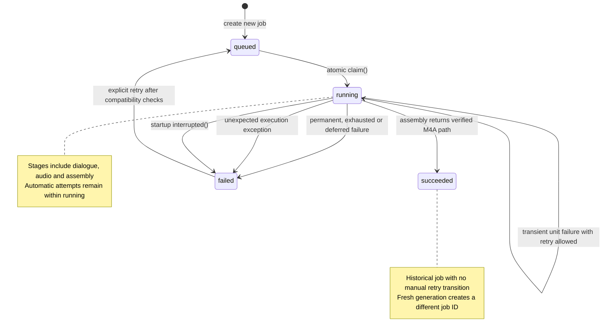
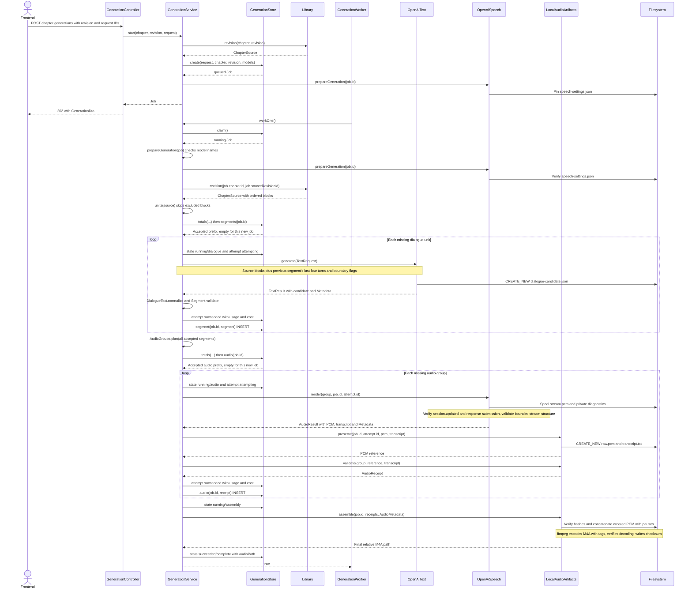
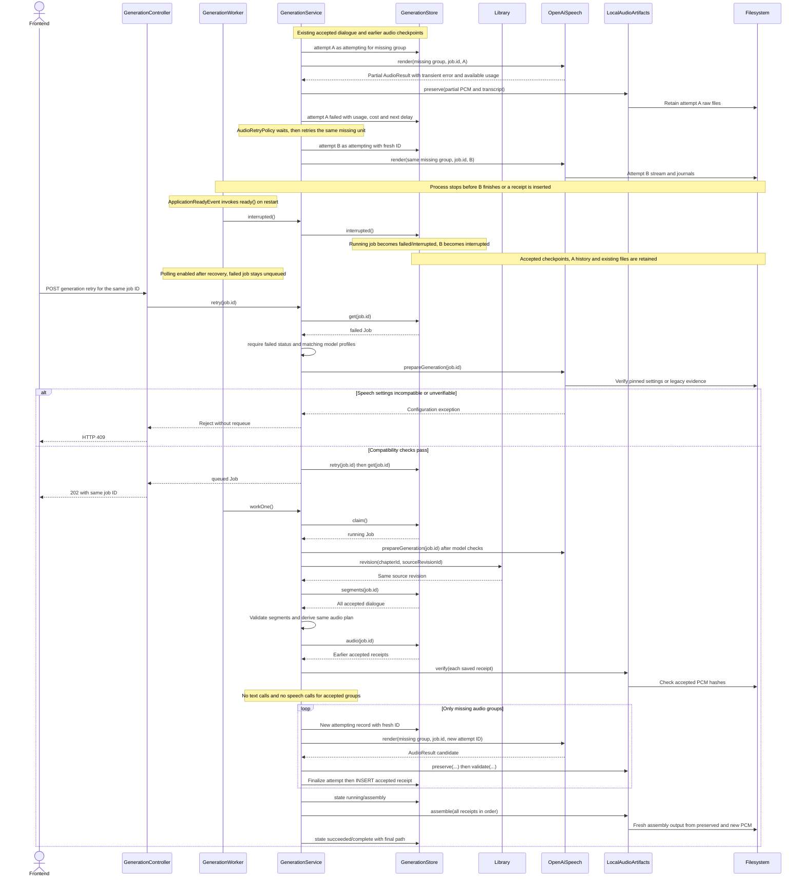

# Generation, retry and recovery

Verified against implementation and existing tests on 2026-11-13. This describes the OpenAI-backed, single-worker deployment. Fake capabilities use the same application orchestration without paid calls. See [DOMAIN_MODEL.md](DOMAIN_MODEL.md) for Java records/ports and [DATA_MODEL.md](DATA_MODEL.md) for relational persistence.

## Persisted job lifecycle

Only these four names are `Podcast.Status` values. The self-transitions below update a running job's stage/progress or retry one missing unit; they are not new queue entries or additional job states.

| Transition / operation | Actual behavior and preconditions |
| --- | --- |
| Creation | `start` validates the selected Chapter/revision, inserts a queued job, then checks model/speech compatibility. A repeated request returns its original job; another request for an active revision returns that active job. The diagram's initial edge applies only to a new insert. |
| Claim | `claim()` uses one `UPDATE ... FOR UPDATE SKIP LOCKED ... RETURNING` statement, setting `running`/`dialogue`. No transaction spans provider work. |
| Running stages | Dialogue attempts use `dialogue`; audio uses `audio` or `audio_retry:<group number>:<attempt number>`; assembly uses `assembly`. Retry-stage group numbers are one-based. Total counters are planned counts; completed counts come from separate accepted-checkpoint reads. |
| Automatic retry | At most three calls per missing segment/group per run, including the initial call. Resilience4j supplies randomized exponential backoff. Only explicitly classified transient results qualify; exceptions do not. Valid Retry-After is a minimum; hints above 60 seconds stop automatic retry and leave the job failed for manual recovery. |
| Failure | Controlled dialogue/audio failures retain their respective stage and transient assessment. `workOne` catches unexpected exceptions and writes `failed`/`failed` with a safe code and `retryable=false`. A failed attempt can be followed by a successful attempt while the job stays running. |
| Completion | Assembly must return after encoding, full decode verification and checksum creation before the service writes `succeeded`/`complete` plus `audioPath`. |
| Manual retry | Requires **failed status**, compatible configured model names and speech settings, and no conflicting active job for the revision. The `retryable` flag is advisory for this action. The same ID is requeued, its error cleared, and checkpoints/attempts retained. Completed jobs are rejected. |
| Startup | `GenerationWorker.ready()` calls interruption recovery before enabling polling. Running jobs become `failed`/`interrupted` with `PROCESS_INTERRUPTED`; still-attempting records become `interrupted`. No failed job is requeued. Jobs already queued remain claimable. |

Attempt `outcome` strings (`attempting`, `succeeded`, `failed`, `interrupted`) are separate from Job status; `retryClassification` and `nextRetryDelayMs` are attempt metadata. Stage strings and counters are not a second durable state machine. Accepted checkpoints survive all these transitions and cannot be updated/deleted through the adapter or under the Flyway triggers.

This is the service/worker transition graph, not a database-enforced state machine. `JdbcGenerationStore.state()` can write any schema-valid status; the conditional manual-retry SQL and the partial active-revision index enforce narrower rules. A completed generation stays historical through the supported service API. Starting another version uses a fresh creation request, new job identity and empty checkpoint history.

Review: [GenerationService](../backend/src/main/java/com/bookcast/app/generation/application/GenerationService.java), [GenerationWorker](../backend/src/main/java/com/bookcast/app/generation/adapter/GenerationWorker.java), [JdbcGenerationStore](../backend/src/main/java/com/bookcast/app/generation/adapter/JdbcGenerationStore.java), [AudioRetryPolicy](../backend/src/main/java/com/bookcast/app/generation/application/AudioRetryPolicy.java), [DialogueRetryPolicy](../backend/src/main/java/com/bookcast/app/generation/application/DialogueRetryPolicy.java). [AudioRetryTest](../backend/src/test/java/com/bookcast/app/AudioRetryTest.java) and [DialogueRetryTest](../backend/src/test/java/com/bookcast/app/DialogueRetryTest.java) cover limits, deferral and interruptions; [GenerationConcurrencyTest](../backend/src/test/java/com/bookcast/app/generation/adapter/GenerationConcurrencyTest.java) verifies atomic claims/idempotency; [GenerationPersistenceTest](../backend/src/test/java/com/bookcast/app/generation/adapter/GenerationPersistenceTest.java) verifies retry/recovery preservation.

## Happy path: new request to M4A

The frontend already has a Chapter snapshot and submits its `sourceRevisionId` with a request UUID. This trace assumes a fresh request with no active job for that revision and successful provider calls. `Store` is the application port implemented by `JdbcGenerationStore`; its checkpoint/attempt messages are PostgreSQL writes, while `Files` is local storage. Capability calls go through the Bookcast interfaces even though the concrete adapters are named below.

This is one possible ordering: the creation transaction commits **before** `prepareGeneration`, so the worker can claim a queued job before the HTTP response returns. A creation-time preparation exception does not roll back the inserted queue row. Preparation is checked at start, worker execution and speech rendering. `GenerationDto` construction also reads accepted scripts, audio and attempts separately; these read calls and repeated frontend polling are omitted above, and the DTO is not an atomic progress snapshot.

Source units retain whole nonexcluded blocks under the current word-budget setting (default 800; an oversized block can stand alone). The service starts with saved dialogue, validates its source IDs/order, appends new segments, and plans audio from the **combined** list. The OpenAI text adapter loads the bundled prompt at construction, uses a strict response schema and preserves a candidate file before application validation. That file is not an accepted script checkpoint.

Speech rendering opens an isolated Realtime session for each group. Configuration acknowledgement and successful response submission are required before accepting completion; bounded event/audio/transcript processing and structural validation can still fail. `LocalAudioArtifacts` then preserves returned bytes/text, checks waveform plausibility and produces a receipt. Provider success, an attempt marked succeeded, and insertion of an accepted checkpoint are separate steps.

Assembly requires group orders starting at zero without gaps, rechecks PCM hashes, inserts 200 ms pauses for the same speaker or 350 ms for a speaker change, and creates fresh scratch PCM/M4A names. Source PCM is copied without trimming. The result is mono 24 kHz AAC-LC M4A with display metadata and a SHA-256 sidecar. Only after success is the job's final path stored. Subsequent controller polling exposes playback/download URLs; `getAudio`/`downloadAudio` serve existing files without generation or re-encoding.

There is no transaction covering HTTP provider calls, WebSocket sessions, backoff, filesystem writes or assembly. `JdbcGenerationStore.create` has a short JDBC transaction; its restricted Spring Data reads share the JDBC transaction manager. Other job commands, attempt upserts and checkpoint inserts remain explicit SQL. Library import transactions are a separate concern.

Review: [OpenAiText](../backend/src/main/java/com/bookcast/app/generation/adapter/openai/OpenAiText.java), [OpenAiSpeech](../backend/src/main/java/com/bookcast/app/generation/adapter/openai/OpenAiSpeech.java), [LocalAudioArtifacts](../backend/src/main/java/com/bookcast/app/generation/adapter/LocalAudioArtifacts.java), [AudioGroups](../backend/src/main/java/com/bookcast/app/generation/domain/AudioGroups.java), [GenerationController](../backend/src/main/java/com/bookcast/app/generation/adapter/GenerationController.java). [ProviderProtocolTest](../backend/src/test/java/com/bookcast/app/generation/adapter/openai/ProviderProtocolTest.java) covers request context/protocol fixtures; [OpenAiSpeechLifecycleTest](../backend/src/test/java/com/bookcast/app/generation/adapter/openai/OpenAiSpeechLifecycleTest.java) covers configuration, completion and resource failures; [ProductFlowTest](../backend/src/test/java/com/bookcast/app/ProductFlowTest.java) covers complete fake-provider execution, preserved originals and file serving.

## Failure, restart and explicit resume

This representative trace starts in the audio stage: all dialogue and some audio groups are accepted. One missing group's first attempt returns a transient error, which is recorded before automatic backoff; the next call is interrupted by process termination. It has no accepted receipt. Partial files can exist without a finished attempt or checkpoint. This example assumes model names match on manual retry; a model mismatch rejects the request before calling speech preparation. The compatible branch shows a successful resume; further failures follow the lifecycle rules above.

Recovery is triggered by backend startup, not a retry request. Its two SQL updates are not wrapped in one transaction. It preserves existing usage/cost fields, marks still-attempting calls as uncertain/interrupted, and leaves accepted rows/files untouched. `ready` becomes true only after both updates return. The deployment assumes one backend; this is not a multi-instance lease/recovery mechanism.

Manual retry checks the failed Job and current text/audio model names, then asks speech rendering to verify its immutable per-job settings snapshot. OpenAI checks model, both voices and speed; legacy jobs require historical attempt evidence. A failure leaves the job failed and makes no provider call. This is not a general configuration snapshot: dialogue prompt/version and source-unit word budget are not pinned per job. The worker checks compatibility and reconstructed plans again after claiming.

Resume uses accepted **prefixes**, not provider attempt counts. Persisted dialogue is validated against newly reconstructed source units; completed segments are not regenerated. The audio plan includes old and new dialogue. Saved receipts must match planned groups and PCM hashes; processing continues after the accepted prefix. SQL keys ensure uniqueness but not contiguous ordering; the sequential writer produces prefixes, and assembly explicitly rejects receipt-order gaps. If every audio group is already accepted, no provider call is needed and assembly can run again.

Existing Segment/AudioReceipt rows, attempt IDs and accounting, accepted PCM/transcripts, failed candidates, stream journals and prior assembly files are preserved. New calls use fresh attempt directories. Assembly uses new scratch/output filenames, so a failed assembly can be retried without rewriting accepted audio. Files written before a crash may be partial; they do not become checkpoints merely by existing.

Additional provider cost is possible only for missing units, including a call interrupted after the provider received it. Automatic retries and a later manual retry can each incur further calls; the per-unit three-attempt budget starts anew on each run. Attempt finalization and checkpoint insertion are separate writes: a crash after a successful call/attempt record but before checkpoint insertion can cause that missing unit to be called again. Saved candidates are not automatically promoted or reused as accepted work. Usage may be unknown even when the provider charged for interrupted work.

Review: [AudioRetryTest](../backend/src/test/java/com/bookcast/app/AudioRetryTest.java) checks interrupted backoff, retained failed usage, skipped completed groups and configuration rejection; [DialogueRetryTest](../backend/src/test/java/com/bookcast/app/DialogueRetryTest.java) checks preserved dialogue, bounded continuity and skipped text calls; [ProductFlowTest](../backend/src/test/java/com/bookcast/app/ProductFlowTest.java) exercises startup/manual recovery with an unchanged accepted PCM hash. [OpenAiSpeechSettingsTest](../backend/src/test/java/com/bookcast/app/generation/adapter/openai/OpenAiSpeechSettingsTest.java) covers legacy/pinned compatibility; [GenerationPersistenceTest](../backend/src/test/java/com/bookcast/app/generation/adapter/GenerationPersistenceTest.java) checks recovery/accounting, advisory manual retryability and checkpoint triggers.

## Verification scope

Diagrams were checked against the linked Java sources, [V1](../backend/src/main/resources/db/migration/V1__library.sql), [V2](../backend/src/main/resources/db/migration/V2__generation.sql), [V3](../backend/src/main/resources/db/migration/V3__book_chapter_numbers.sql), and the existing tests named above. No jobs or providers were run for this documentation. No local Mermaid renderer was available; visual rendering was not verified. The diagrams use ordinary class, state and sequence syntax without HTML labels or custom rendering configuration.
